<div align="center">

# floe

### A quiet room for loud minds.

A pomodoro timer that lives inside slow, moving worlds: hand-drawn live scenes, Spotify, an ambient sound mixer, synced accounts and an admin dashboard.

[](https://floe-focus.netlify.app)
[](https://floe-focus.netlify.app/app)


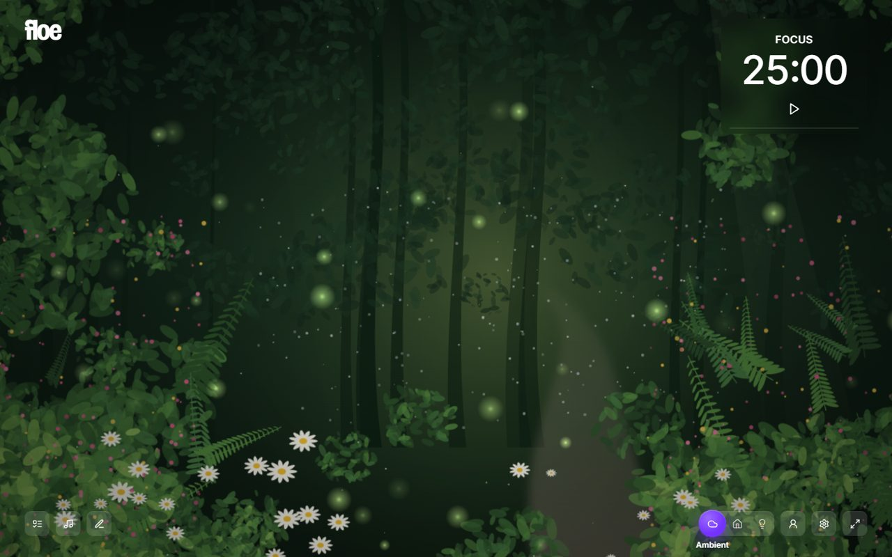

</div>

---

## Contents

- [Highlights](#highlights)
- [Screenshots](#screenshots)
- [Tech stack](#tech-stack)
- [System architecture](#system-architecture)
- [System design](#system-design)
- [Data model](#data-model)
- [Security model](#security-model)
- [Design system](#design-system)
- [Getting started](#getting-started)
- [Configuration](#configuration)
- [Deployment](#deployment)
- [Project structure](#project-structure)
- [Keyboard shortcuts](#keyboard-shortcuts)

---

## Highlights

| | Feature | What it does |
|---|---|---|
| 🌲 | **11 live scenes** | Enchanted Forest, Rainy City, Starry Night, Aurora, Winter Cabin, Synthwave, Ocean Sunset, Sakura, Pixel Valley, Pastel Park and Cozy Cat, all drawn live on `<canvas>` (no video files). |
| 🎨 | **Themes for every mode** | Ambient, Home and Focus each get their own background: scenes, grainy gradients, flat "paper" colors, 24/7 lofi YouTube streams, or your own image / video / YouTube link (uploads stay in IndexedDB). Light themes switch the UI to dark text automatically. |
| ⏱️ | **8 clock styles, everywhere** | Classic, 3D Flip, Ring, Analog, Minimal, Pixel, Words and Poster, for the Home clock, the Focus countdown and the Ambient timer card. In countdown modes they adapt: Analog becomes a kitchen-timer dial, Words reads "twenty-four minutes left". |
| 🎛️ | **Every mode customizable** | Per mode: clock style, progress style (Ring, 3D Orbit, Bar, Glow), companion, its position and size, and which pieces show (greeting, quote, tabs, cycle, task, timer card). One click on **Customize** (or `C`). |
| 🪐 | **Live session progress** | While a session runs, the Home clock shows a 3D tilted orbit ring, a bar or a breathing glow. The color drifts violet → magenta → coral as the session ends (teal → sky on breaks). |
| 🐾 | **6 companions** | Tomato, Sprout (grows as you level), Mochi the cat, Kit the fox, Boo the ghost and Bit the robot, each with their own work / break / idle / pause animations, speech bubbles and Lively / Calm / Still motion. |
| 🏆 | **Levels & rewards** | Earn XP for focus minutes, finished tasks and active days. Level up to unlock companions, accessories (headphones, party hat, flower crown, wizard hat, crown) and effects (sparkle aura, golden glow), with a confetti celebration. Admins can grant XP. |
| 🎧 | **Spotify** | Embedded player that works for everyone, one-click **Connect Spotify** (OAuth PKCE, Client ID built in, so users never see developer setup), search across Spotify + your playlists, and play/pause/skip on your devices. |
| 🌧️ | **Sound mixer** | Rain, waves, wind, fireplace, birds and white/pink/brown noise, synthesized in real time with the Web Audio API. |
| ✅ | **Tasks & notes** | Draggable glass panels. Pin a task to the timer and floe counts the sessions it took. |
| 📊 | **Stats** | Focus calendar heatmap, trend chart, streaks, sessions and break time. No paywall. |
| 💬 | **220+ quotes** | Curated motivational quotes with authors, plus live extras from [QuotesDB](https://quotes-db.vercel.app/) when it's reachable. |
| 🔐 | **Members only** | `/app` requires an account. New people can sign up, or tap **Ask the owner for an account**: a short form opens WhatsApp (or email) with their name, email, preferred username and reason already written out. |
| 👤 | **Accounts & sync** | Sign in with **email or username**. Tasks, notes, settings and stats sync across devices via Supabase. Signing out clears the device, so shared computers stay private. |
| 🛡️ | **Admin dashboard** | `/admin`: live stats & charts, user directory with levels, create accounts (with a one-click **copy credentials + link** button), grant XP, promote to moderator/admin, suspend, reset passwords, delete. |
| ✨ | **Landing page** | WebGL shader blob hero, a 3D browser mockup that tilts into view on scroll, a 3D carousel of live scenes, and interactive demos. |

## Screenshots

| Landing | Home with session orbit |
|---|---|
| 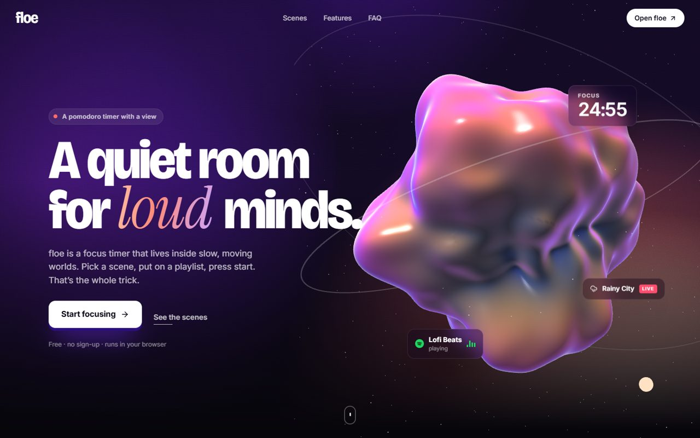 | 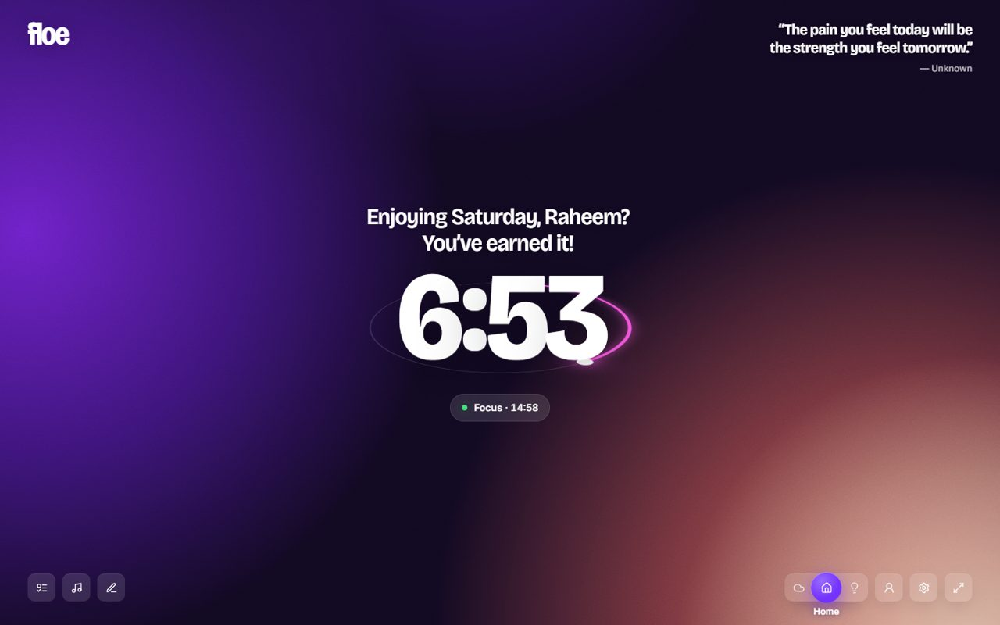 |
| **Focus + tomato companion (Pixel Valley)** | **Ring clock (Aurora)** |
| 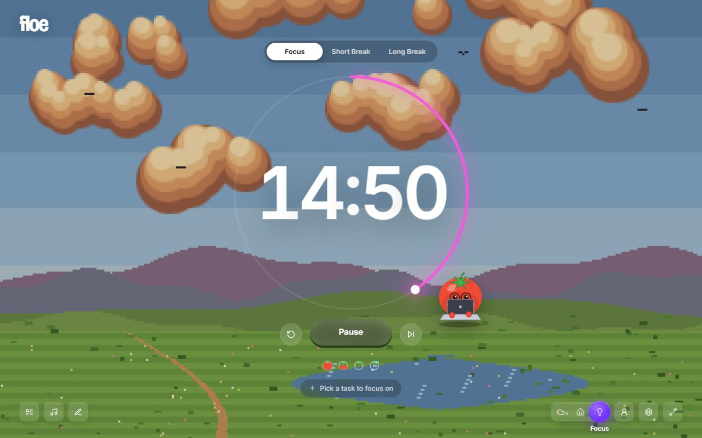 | 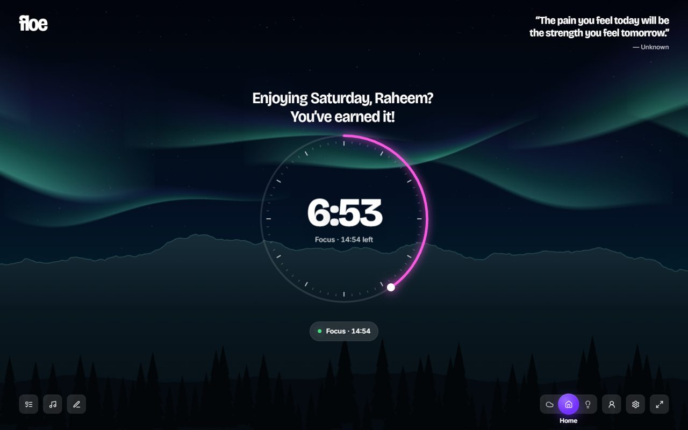 |
| **Light theme (Cozy Cat)** | **Panels: Spotify search & tasks** |
| 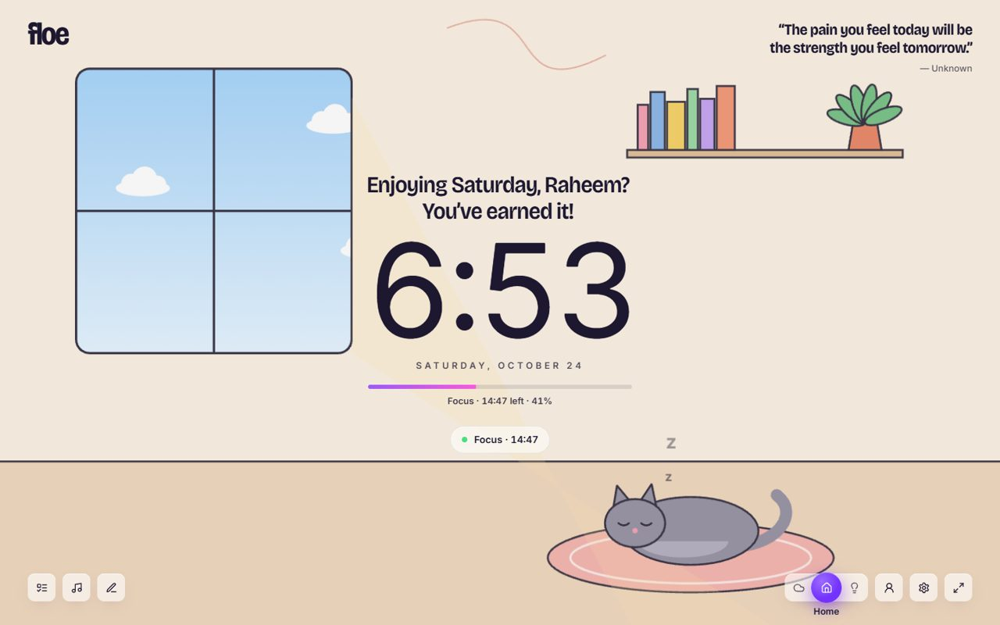 | 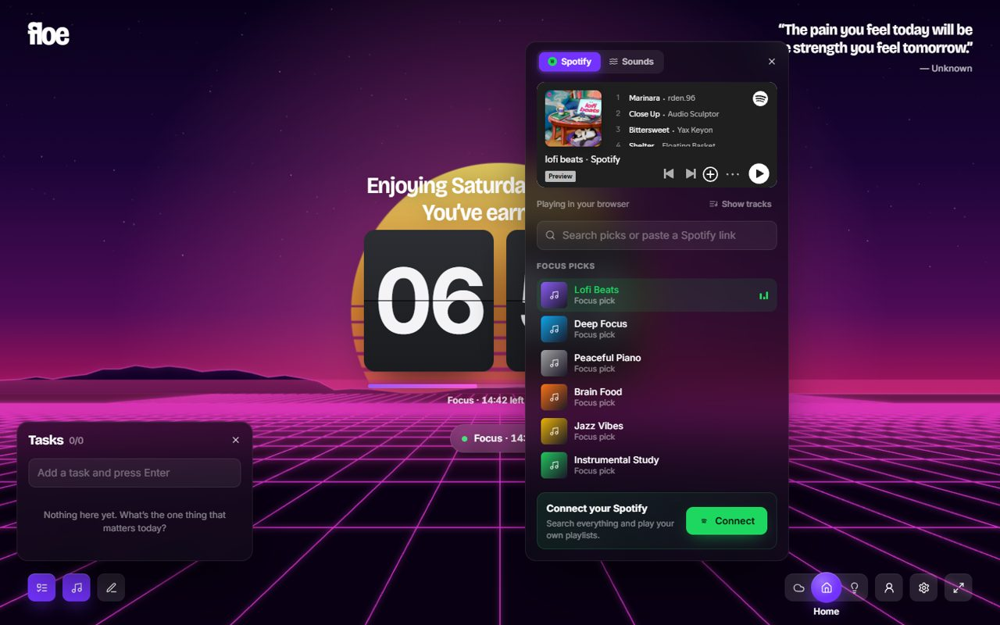 |
| **Themes** | **Stats** |
| 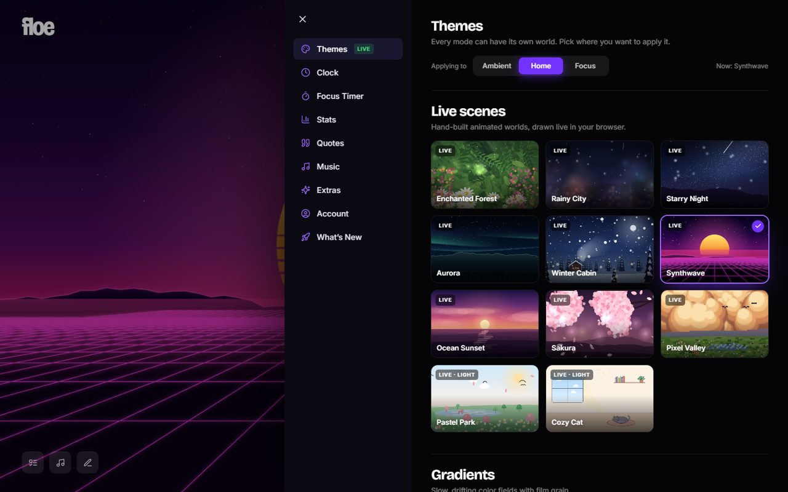 | 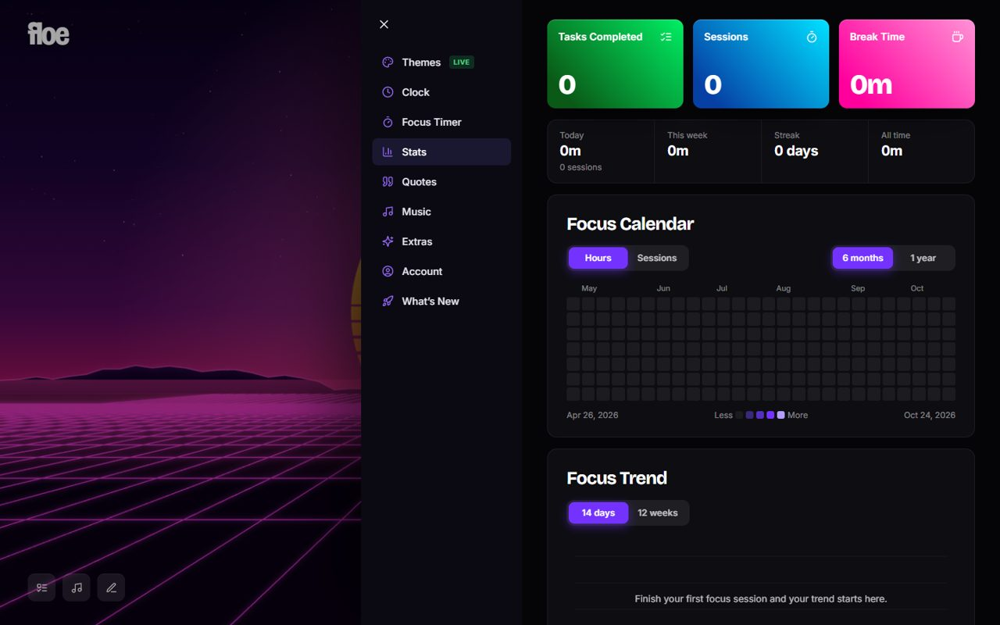 |

---

## Tech stack

| Layer | Technology | Why |
|---|---|---|
| UI | **React 18** + **TypeScript** | Component model, strict typing end to end |
| Build | **Vite 5** | Instant dev server, code-split routes (`/`, `/app`, `/admin`) |
| State | **Zustand** + `persist` | Tiny store; the whole app works offline from `localStorage` |
| Graphics | **Canvas 2D** (scenes), **Three.js** + custom GLSL (landing hero), **SVG** (clocks, charts, companion) | Live, resolution-independent visuals with no media downloads |
| Audio | **Web Audio API** | Alarm chimes and an ambient mixer generated from noise and oscillators |
| Auth & DB | **Supabase**: Postgres, Auth, Row Level Security, RPC functions | Accounts, sync and admin analytics without running a server |
| Server logic | **Supabase Edge Functions** (Deno) | Privileged admin actions and username login, keeping the service-role key off the client |
| Music | **Spotify Web API** (Authorization Code + PKCE) + Spotify embeds | No backend, no client secret |
| Hosting | **Netlify** | Static CDN hosting with SPA routing and security headers |
| Fonts | Bricolage Grotesque, Inter, Instrument Serif, VT323 | Editorial display type, clean UI type, serif accents, a pixel face |

---

## System architecture

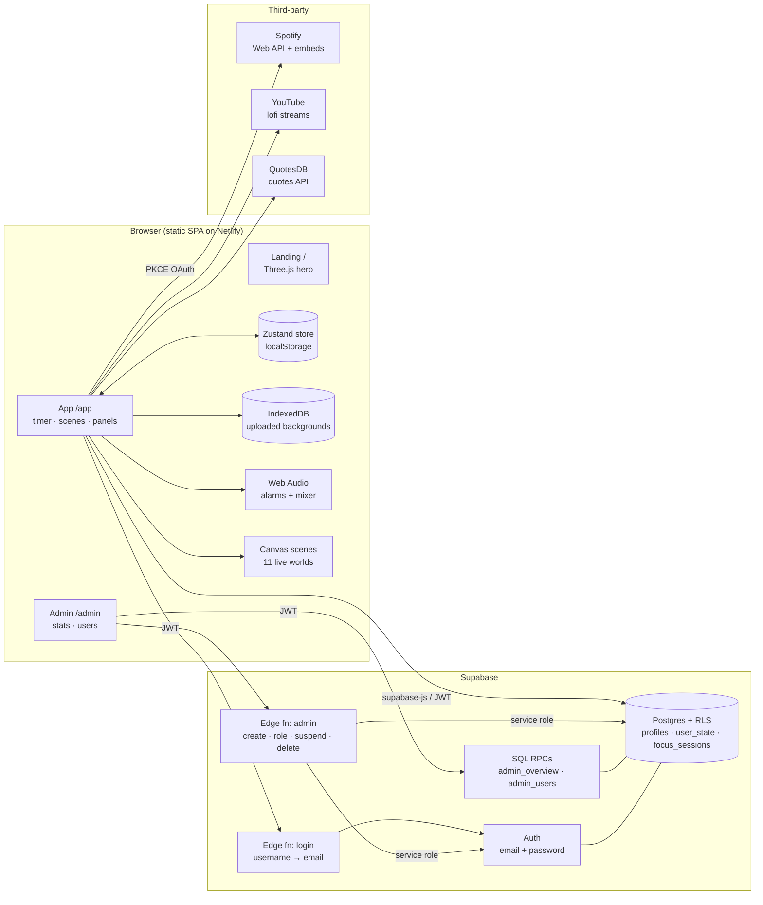

## System design

### 1. Timer engine

The timer stores an absolute `endAt` timestamp rather than counting ticks, so it stays exact through tab sleep, reloads and throttled background tabs. A single 250 ms loop updates a shared `now` store, checks completion, plays the alarm, fires a notification and rolls into the next mode.

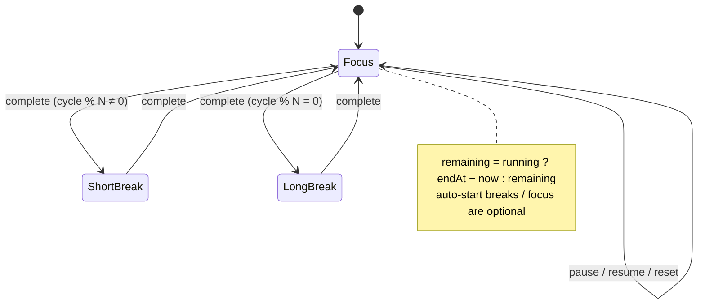

### 2. Sign in with username *or* email

Usernames are resolved to emails **on the server**, so the browser never learns another user's email.

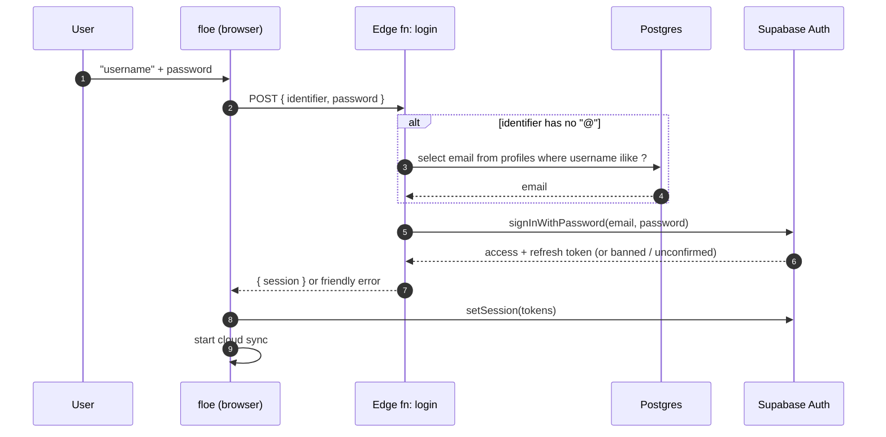

### 3. Cloud sync

Local state is always the source of truth while you use the app. On sign-in floe merges with the cloud copy, then pushes changes, debounced by 2.5 s.

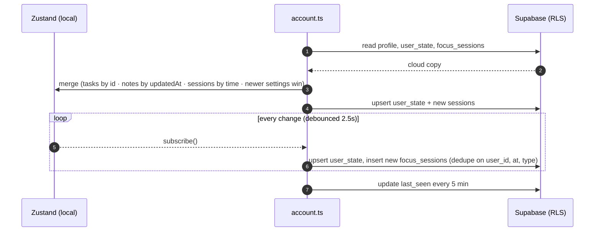

### 4. Admin: create an account

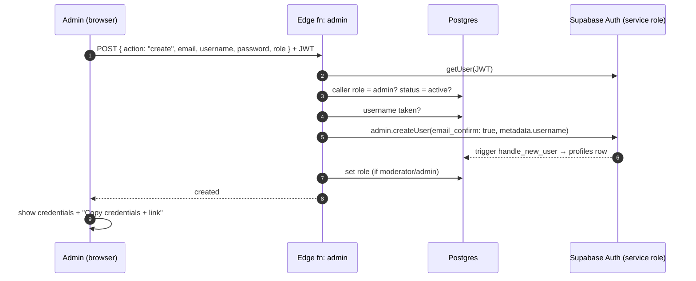

### 5. Rendering pipeline for live scenes

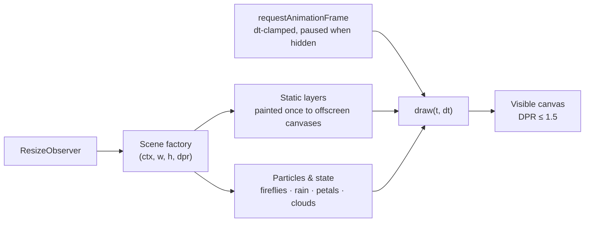

Pixel Valley is painted at about ¼ resolution and scaled up with `imageSmoothingEnabled = false` for crisp pixel art. Theme thumbnails are rendered from the real scene code a few frames in.

---

## Data model

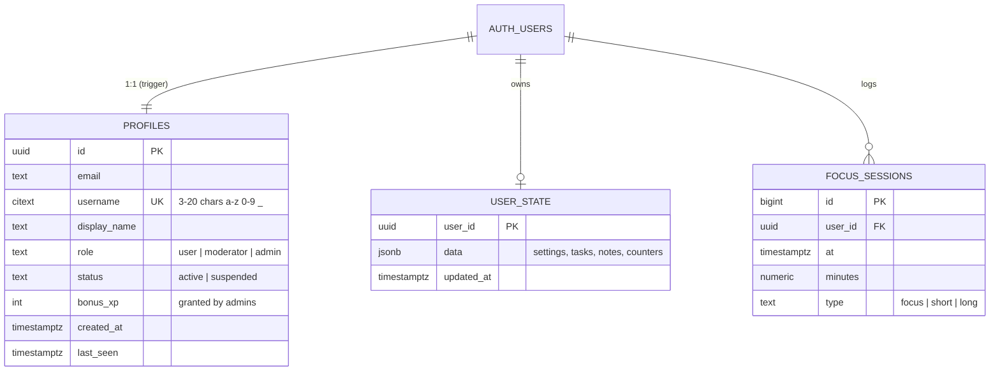

SQL lives in [`supabase/schema.sql`](supabase/schema.sql), [`002_roles_usernames.sql`](supabase/002_roles_usernames.sql) and [`003_xp.sql`](supabase/003_xp.sql). Edge functions are in [`supabase/functions`](supabase/functions).

## Security model

| Concern | How it's handled |
|---|---|
| Keys in the browser | Only the Supabase **publishable** key and URL ship to the client. The service-role key exists only inside Edge Functions. |
| Data isolation | Row Level Security on every table. Users read and write only their own `user_state` and `focus_sessions`. |
| Privilege escalation | Column-level grants: users may update only `display_name` and `last_seen` on their profile, never `role` or `status`. |
| Admin reads | `SECURITY DEFINER` RPCs that check `is_staff()` inside Postgres. Anonymous callers are denied at the grant level. |
| Admin writes | The `admin` Edge Function re-reads the caller's role on every request. Moderators can only suspend regular users, nobody can act on their own account, and the last admin can't be removed. |
| Suspension | Enforced by Supabase Auth bans, so suspended users can't sign in or refresh tokens. |
| Username login | Resolved server-side, with a single generic error message so it can't be used to discover accounts. |
| Spotify | OAuth Authorization Code + PKCE. No client secret exists. |
| Notes privacy | Admins see usage stats, never the contents of anyone's notes or tasks. |

---

## Design system

| Token | Color | Used for |
|---|---|---|
| Accent |  `#7432ff` | Active states, buttons, dock indicator |
| Accent light |  `#9b6bff` | Charts, icons, focus rings |
| Coral |  `#ff7a59` | End-of-session color, accents |
| Ink |  `#07060b` | App and landing background |
| Panel |  `#0e0d15` | Cards, settings, admin surfaces |
| Success |  `#34d399` | Active status, sync OK |
| Danger |  `#f87171` | Suspended, delete |
| Spotify |  `#1ed760` | Spotify actions |
| Tasks / Sessions / Breaks |    | Stat cards |

**Motion:** springy `cubic-bezier(.34,1.56,.64,1)` for things that pop, and a long ease-out `cubic-bezier(.22,1,.36,1)` for things that glide. 3D comes from CSS `perspective` (tilt cards, flip clock, the orbit ring, panel openings, the drawer) plus mouse-driven parallax (`--mx` / `--my`). Everything respects `prefers-reduced-motion`.

---

## Getting started

**Requirements:** Node 20+ and npm.

```bash
git clone https://github.com/raheemxghumman/floe.git
cd floe
npm install
cp .env.example .env.local   # fill in the values below (all optional)
npm run dev
```

Open **http://127.0.0.1:5173**. Use `127.0.0.1`, not `localhost`: Spotify only accepts loopback IPs as redirect URIs.

| Route | What |
|---|---|
| `/` | Landing page (public) |
| `/app` | The app (sign-in required when Supabase is configured) |
| `/admin` | Admin dashboard (admins and moderators) |

Without any configuration floe runs fully local: no accounts, everything saved in the browser.

## Configuration

| Variable | Required | Where to get it |
|---|---|---|
| `VITE_SUPABASE_URL` | for accounts | Supabase → Project Settings → API |
| `VITE_SUPABASE_ANON_KEY` | for accounts | Supabase → API keys → **publishable** key (safe to expose) |
| `VITE_SPOTIFY_CLIENT_ID` | for "Connect Spotify" | [Spotify Developer Dashboard](https://developer.spotify.com/dashboard) → Create app → Web API. Public identifier; with it set, users just click Connect |
| `VITE_OWNER_NAME` / `VITE_OWNER_EMAIL` / `VITE_OWNER_WHATSAPP` | optional | Contact details shown on the sign-in screen for account requests (WhatsApp in international digits, e.g. `923001234567`) |

**Supabase setup (new project):**

1. Run `supabase/schema.sql`, `supabase/002_roles_usernames.sql` and `supabase/003_xp.sql` in the SQL editor.
2. Deploy the functions: `supabase functions deploy admin` and `supabase functions deploy login --no-verify-jwt`.
3. Auth → URL configuration: set the Site URL to `https://<your-site>/app` and add `https://<your-site>/**` and `http://127.0.0.1:5173/**` to the redirect URLs.
4. Create your first account, then make it an admin: `update profiles set role = 'admin' where username = '<you>';`

**Spotify setup:** add `http://127.0.0.1:5173/app` and `https://<your-site>/app` as redirect URIs. New Spotify apps are in Development mode: your account works, and up to 25 others can be added under User Management. Anyone not on the list sees a friendly notice with a one-tap WhatsApp request instead of an error. Apply for Extended Quota to open it to everyone.

## Deployment

floe is a static site.

```bash
npm run build        # → dist/
```

- **Netlify:** `netlify.toml`, `public/_redirects` (SPA routing) and `public/_headers` (security + immutable asset caching) are included. Add the `VITE_*` variables under Site settings → Environment variables.
- Any static host works if it rewrites unknown paths to `/index.html`.

---

## Project structure

```
floe/
├─ public/                  _redirects, _headers, favicon
├─ supabase/
│  ├─ schema.sql            tables, RLS, trigger, admin RPCs
│  ├─ 002_roles_usernames.sql
│  └─ functions/
│     ├─ admin/index.ts     create · set_role · suspend · delete · reset_password
│     └─ login/index.ts     username-or-email sign in
├─ src/
│  ├─ main.tsx              route split: / · /app · /admin
│  ├─ App.tsx               app shell
│  ├─ store.ts              Zustand store: timer, settings, tasks, notes, stats
│  ├─ hooks.ts              timer engine, shortcuts, idle, parallax, toasts
│  ├─ themes.ts             theme catalog (scenes, gradients, paper, streams)
│  ├─ scenes/               11 canvas scenes + helpers
│  ├─ components/
│  │  ├─ clocks.tsx         8 time-display styles, progress frames
│  │  ├─ companions.tsx     6 companions, accessories, effects
│  │  ├─ LevelUp.tsx        level-up celebration
│  │  ├─ views.tsx          Home, Ambient timer card, Focus
│  │  ├─ Background.tsx     cross-fading theme renderer
│  │  ├─ panels/            Tasks, Notes, Music (Spotify + sounds)
│  │  ├─ settings/          drawer, themes, stats, sections
│  │  └─ AuthForm.tsx
│  ├─ admin/                dashboard, charts
│  ├─ landing/              landing page + Three.js hero
│  ├─ lib/                  audio, spotify, supabase, account sync, levels/XP, quotes, media
│  └─ styles/
└─ docs/screenshots/
```

## Keyboard shortcuts

| Key | Action | Key | Action |
|---|---|---|---|
| `Space` | Start / pause | `T` | Tasks |
| `R` | Reset | `M` | Music |
| `N` | Next session | `J` | Notes |
| `1` `2` `3` | Ambient · Home · Focus | `F` | Fullscreen |
| `,` | Settings | `C` | Customize this mode |
| `Esc` | Close | | |

---

<div align="center">

Built for deep work. Inspired by the calm of <a href="https://flocus.com">Flocus</a>.

</div>
